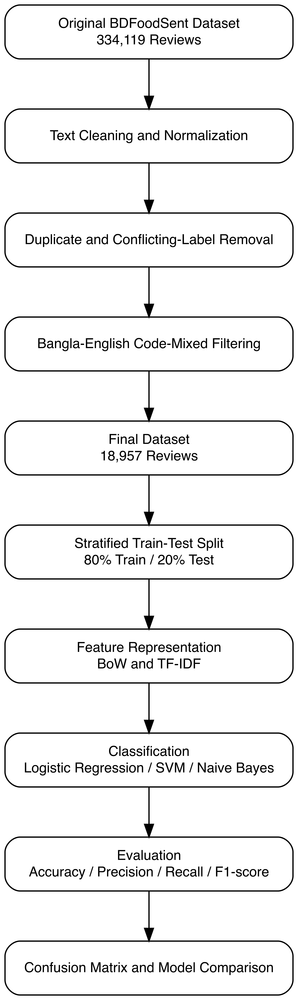
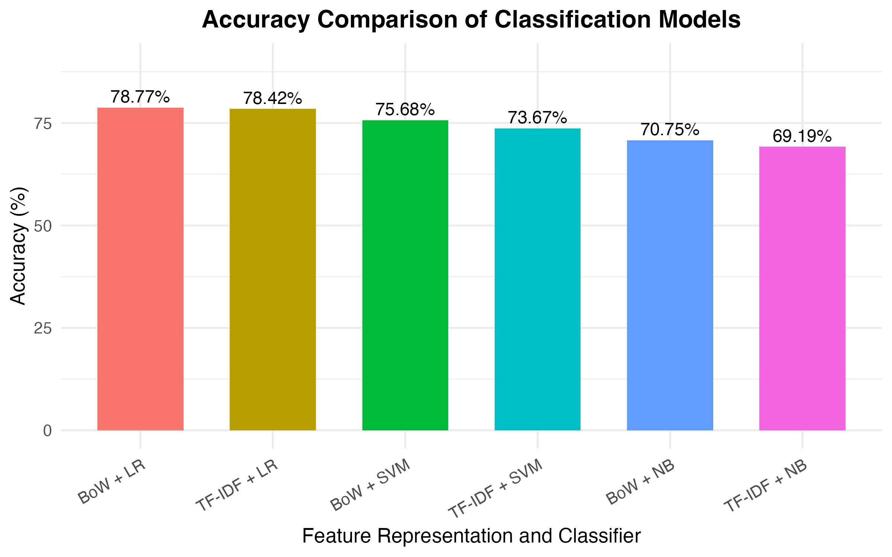
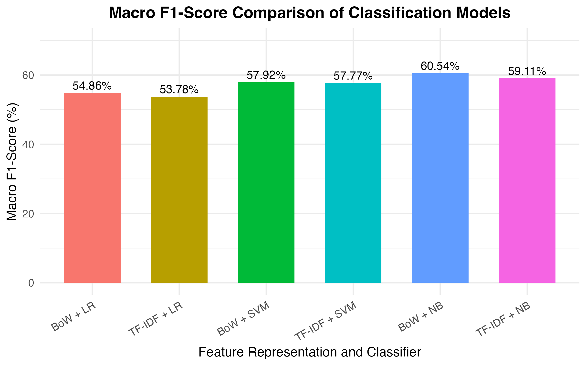
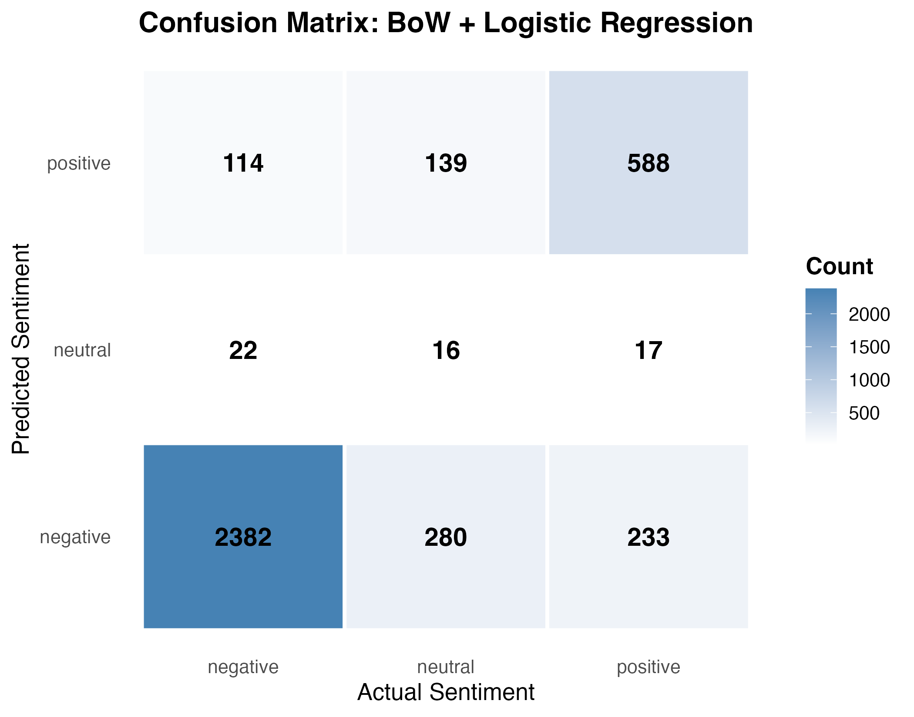
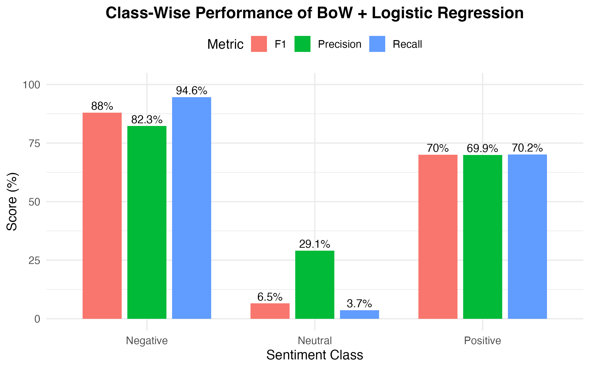

# Bangla–English Code-Mixed Sentiment Classification

**A Comparative Study of BoW and TF-IDF with Traditional Machine Learning Models**

Introduction to Data Science — Final Project (Group 09)
Department of Computer Science and Engineering, American International University-Bangladesh (AIUB)

📄 **Paper:** [`paper/IDS_IEEE_Paper.pdf`](paper/IDS_IEEE_Paper.pdf)

---

## Overview

Bangla–English code-mixed ("Banglish") restaurant reviews mix English vocabulary with Romanized Bangla expressions and informal spellings. This project builds a code-mixed subset of the **BDFoodSent** dataset and compares two sparse text representations — **Bag of Words (BoW)** and **TF-IDF** — across three classical classifiers: **Logistic Regression (LR)**, **linear SVM**, and **Multinomial Naive Bayes (NB)**.

### Key findings

- **BoW + LR** gives the highest **accuracy (78.77%)**.
- **BoW + NB** gives the highest **macro F1 (60.54%)**.
- BoW outperforms TF-IDF on both metrics for every classifier on this split.
- High accuracy hides weak minority-class performance: BoW + LR recognises only **16 of 435 neutral** test reviews (3.68% neutral recall).

## Dataset

| Stage | Reviews |
|---|---:|
| Original BDFoodSent | 334,119 |
| After cleaning, de-duplication & strict code-mixed filtering | 18,957 |
| Train (stratified 80%, seed 42) | 15,166 |
| Test (stratified 20%) | 3,791 |

Labels are derived from star ratings: **1–2 → negative**, **3 → neutral**, **4–5 → positive**.
Class distribution: 12,591 negative (66.4%), 2,176 neutral (11.5%), 4,190 positive (22.1%).

**Source:** E. R. Rhythm and M. H. K. Mehedi, *BDFoodSent: A Large-Scale Sentiment-Labeled Restaurant Review Dataset from Bangladesh*, Mendeley Data, v2, 2024. DOI: [10.17632/532fxhnwbb.2](https://data.mendeley.com/datasets/532fxhnwbb/2) — CC BY 4.0.

> The raw file (`BDFoodSent-334k.csv`, ~132 MB) exceeds GitHub's file size limit and is not included. See [`data/raw/README.md`](data/raw/README.md) for download instructions. The processed subset and train/test splits are included in [`data/processed/`](data/processed/).

## Methodology



1. **Preprocessing** — lowercase, remove URLs, punctuation and digits, normalise whitespace.
2. **De-duplication** — group by normalised text; drop groups with conflicting labels, keep one copy of consistent duplicates.
3. **Code-mixed filtering** — keep reviews containing both Romanized Bangla and English lexical indicators.
4. **Split** — stratified 80/20 train/test split (seed 42).
5. **Features** — BoW and TF-IDF document-feature matrices (`quanteda`).
6. **Models** — Logistic Regression, linear SVM (`LiblineaR`), Multinomial Naive Bayes.
7. **Evaluation** — accuracy, macro precision, macro recall, macro F1, confusion matrix, class-wise metrics.

## Results

| Model | Accuracy (%) | Macro Precision (%) | Macro Recall (%) | Macro F1 (%) |
|---|---:|---:|---:|---:|
| **BoW + LR** | **78.77** | **60.43** | 56.15 | 54.86 |
| TF-IDF + LR | 78.42 | 59.63 | 55.21 | 53.78 |
| BoW + SVM | 75.68 | 58.40 | 58.00 | 57.92 |
| TF-IDF + SVM | 73.67 | 57.78 | 57.82 | 57.77 |
| **BoW + NB** | 70.75 | 60.28 | **63.69** | **60.54** |
| TF-IDF + NB | 69.19 | 59.10 | 62.41 | 59.11 |

<p align="center">
  
  
</p>
<p align="center">
  
  
</p>

## Repository structure

```
banglish-sentiment-analysis/
├── data/
│   ├── raw/                  # BDFoodSent-334k.csv (download separately)
│   └── processed/            # Code-mixed subset + train/test splits
├── figures/                  # All figures used in the paper
├── paper/                    # IEEE-format project report (PDF + DOCX)
├── scripts/
│   └── sentiment_analysis.R  # Full pipeline: cleaning → modelling → figures
└── banglish-sentiment-analysis.Rproj
```

## How to run

1. Install R (≥ 4.2) and the required packages:

   ```r
   install.packages(c(
     "tidyverse", "caret", "quanteda", "quanteda.textmodels",
     "LiblineaR", "DiagrammeR", "DiagrammeRsvg", "rsvg"
   ))
   ```

2. Download `BDFoodSent-334k.csv` into `data/raw/`.
3. Open `banglish-sentiment-analysis.Rproj` in RStudio (this sets the working directory to the repository root).
4. Run `scripts/sentiment_analysis.R`. Outputs are written to `data/processed/` and `figures/`.

## Limitations

- Code-mixed selection uses a lexical heuristic, not verified language identification.
- Labels come from ratings and may not match the sentiment expressed in the text.
- Results are from a single stratified split; no significance testing was performed.

## Authors

- Sadia Ahmed
- Samiul Hasan
- MD. Saiful Islam Shanto
- Tahmid Yousuf Prince
